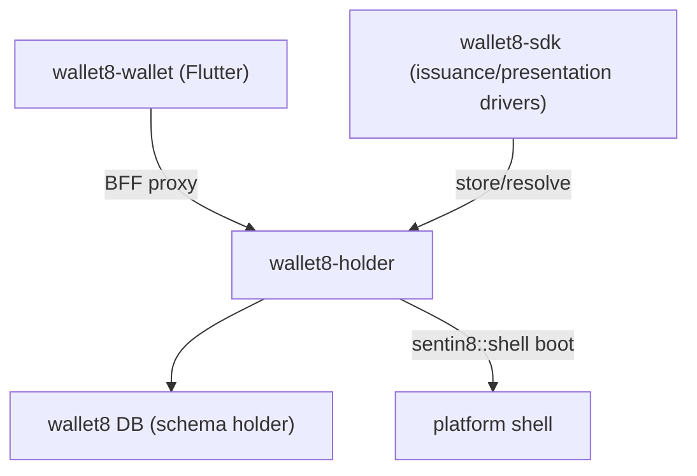

# Wallet8 Holder - Detailed Design Document

## 1. Scope & Context

The holder backend: the encrypted credential vault, the device-key
registry, the presentation history. It owns the wallet's PERSISTED
state; the protocol drivers live in wallet8-sdk (the crates) and
wallet8-flutter (the app).

## 2. Runtime Architecture

The `sentin8-shell` boot: registration flag, PQ provider, config,
the capped pool, state binding, OpenAPI merge, middleware, the PQ-TLS
listener. The service supplies registration (the admin scopes, the
RFW pages, the pg roles, the m2m grants), the state (pool + env + the
vault's data key), and the routes.

## 3. Data Model

The three RLS-forced tables under the service's own `holder` schema
inside the wallet8 vertical database (schema-per-service, DBX §6.6 -
the same layout bank8:ledger's `ledger.*` uses): `holder.credentials`,
`holder.device_keys`, `holder.presentations` - see the vertical
DESIGN.md §3. The credential material column (`credential_ct`) stores
the AES-256-GCM envelope (`sentin8::crypto::seal_str`); the key
derives from the `WALLET8_HOLDER_DATA_KEY` service secret. Every
query is schema-qualified (no search_path dependence).

## 3a. Spec-first implementation (the governing directive)

The wallet8 SDK clients are implementations of the normative
specifications, section by section. The OIDF conformance suite
VERIFIES behavior; the contracts are the specifications themselves
(the full baseline catalog: the vertical's `BUSINESS.md` §3; the
section-by-section map: the vertical's `DESIGN.md` §3a):

- **OID4VCI 1.0 Final** (16 Sep 2025) - the issuance client: offer
  intake by value/reference (§4.1.2/4.1.3), the metadata identity
  check (§12.2.2), the authorization-server selection (§12.2.4), the
  pre-authorized exchange + tx_code (§6.1), the anonymous form
  (§12.3), the nonce endpoint (§7), the jwt proof (App. F.1), the
  credential endpoint (§8.2/8.3), the deferred form (§9), the
  notifications (§11).
- **OID4VP 1.0 Final** (9 Jul 2025) - the presentation client: the
  request shape gate (§5.1/5.2/8.2), DCQL (§6) with the exact §6.4.1
  claim_sets + §6.4.2 credential_sets selection rules, the claims
  path pointer (§7), the vp_token (§8.1), direct_post (§8.2), the
  error vocabulary (§8.5), the KB-JWT (B.3.6), the B.2.6.1/6.2
  session transcripts, the DC API origins (App. A).
- The vault's own obligations come from the same texts: encrypted
  storage (OID4VCI §15.3), the presentation-history audit (OID4VP
  §15.1), and the status checks (IETF Token Status List draft-14;
  ISO/IEC 18013-7 deferred per the vertical DESIGN.md §10).

Every SDK function cites its section. When a suite check and the
specification disagree, the specification wins - and the suite
finding is re-examined against the text.

## 4. API Surface

See the vertical DESIGN.md §4. Every handler: the RLS context set +
the query on ONE transaction.

## 5. Cross-Cutting Concerns

The Shield gate precedes every handler in the deployed fleet (the BFF
proxy carries the verified user claim); the vault's scoped read
(`GET /v1/credential/{id}`) is the only material-returning surface.

## 6. Failure Modes & Recovery

A sealed-write failure rolls the whole intake back (the issuance flow
retries); a key-derivation failure fails the boot (fail-closed).

## 7. Concurrency & Performance Model

Read-mostly vault; the pool cap 3. The presentation resolve is a
single-row read + an unseal.

## 8. Invariants, Insecure-Defaults Rejected

Ciphertext-only persistence; RLS forced; the thumbprint uniqueness
per env (the same key re-registers idempotently).

## 9. Testing Strategy

The in-crate unit tests (the thumbprint form); the e2e flows through
the BFF proxy.

## 10. Open Questions

The vault's export/import surface (wallet migration between devices) -
deferred.
