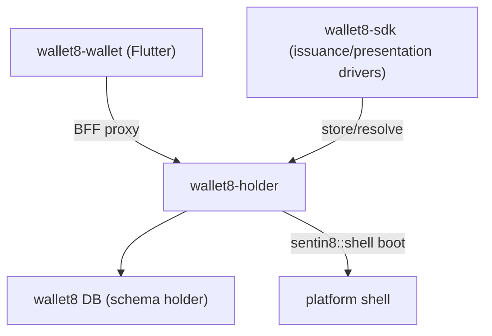

# Wallet8 Holder - Detailed Design Document

## 1. Scope & Context

The holder backend: the encrypted credential vault, the device-key
registry, the presentation history. It owns the wallet's PERSISTED
state; the protocol drivers live in wallet8-sdk (the crates) and
wallet8-flutter (the app).

## 2. Runtime Architecture

The `sentin8-shell` boot: registration flag, PQ provider, config,
the capped pool, state binding, OpenAPI merge, middleware, the PQ-TLS
listener. The service supplies registration (the admin scopes, the
RFW pages, the pg roles, the m2m grants), the state (pool + env + the
vault's data key), and the routes.

## 3. Data Model

The three RLS-forced tables (`credentials`, `device_keys`,
`presentations`) - see the vertical DESIGN.md §3. The credential
material column (`credential_ct`) stores the AES-256-GCM envelope
(`sentin8::crypto::seal_str`); the key derives from the
`WALLET8_HOLDER_DATA_KEY` service secret.

## 4. API Surface

See the vertical DESIGN.md §4. Every handler: the RLS context set +
the query on ONE transaction.

## 5. Cross-Cutting Concerns

The Shield gate precedes every handler in the deployed fleet (the BFF
proxy carries the verified user claim); the vault's scoped read
(`GET /v1/credential/{id}`) is the only material-returning surface.

## 6. Failure Modes & Recovery

A sealed-write failure rolls the whole intake back (the issuance flow
retries); a key-derivation failure fails the boot (fail-closed).

## 7. Concurrency & Performance Model

Read-mostly vault; the pool cap 3. The presentation resolve is a
single-row read + an unseal.

## 8. Invariants, Insecure-Defaults Rejected

Ciphertext-only persistence; RLS forced; the thumbprint uniqueness
per env (the same key re-registers idempotently).

## 9. Testing Strategy

The in-crate unit tests (the thumbprint form); the e2e flows through
the BFF proxy.

## 10. Open Questions

The vault's export/import surface (wallet migration between devices) -
deferred.
